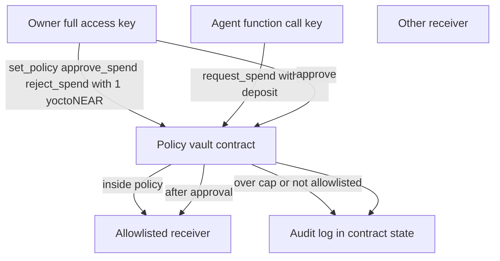

# Agent CRS

A release check for agent spending on NEAR testnet. The vault holds the NEAR. The agent holds only a function call key that can ask for a spend. The contract pays only when the receiver is allowlisted and the amount fits the per transaction cap and the daily cap. Anything else waits for the owner, or is denied. Every proposal, queue, approval, rejection, and execution is stored in the contract and shown on a small board.

This is a NEAR Hackathon 2026 project for track 06, AI Security & Defense (`security`). It was built by Isaac Adekunle / Drew & Crew with AI coding agents.

This is a separate project from the author's PayPal hackathon entry, Approve before Pay. The two projects do not share a repository, a contract, or a product.

Prize payout account: not set. Isaac will supply a mainnet address before submission. This repository does not invent one.

## Problem

An agent that can sign with a full access key can move every token on the account. Tests of the agent do not change that. Agent CRS puts the money in a contract and gives the agent a key that cannot transfer NEAR and cannot call the approval methods. The contract is fail closed: an empty allowlist, a zero cap, a pause, or an unknown receiver does not pay.

The name is an analogy for a human release check. It is not a certification, and it is not affiliated with any aviation authority.

## What NEAR does here

A function call key can sign calls to one contract and, if method names are set, only those methods. It cannot attach a deposit, so it cannot pass the one yoctoNEAR check on `approve_spend`, `reject_spend`, `set_policy`, or `set_paused`. The protocol rejected a real `approve_spend` from the agent key with `MethodNameMismatch` before the contract ran.

The vault account moves the NEAR with `Promise::transfer` after the policy check. The agent never receives a full access key in the running demo. After setup, the agent account's full access key was deleted. `view_access_key_list` shows one function call key for `request_spend` on the vault.

Checked against the live rules and docs on 11 Nov 2026:

- Track 06 and testnet eligibility: [HACKATHON.md](https://nearhackathon.com/HACKATHON.md) (Q-010, Q-011). Development ends 14 Nov 2026 23:59 UTC.
- Access keys: [docs.near.org/protocol/accounts-contracts/access-keys](https://docs.near.org/protocol/accounts-contracts/access-keys).
- One yoctoNEAR: [docs.near.org/smart-contracts/security/one_yocto](https://docs.near.org/smart-contracts/security/one_yocto).
- Contract SDK: `near-sdk` 5.30.1 (Rust). The crates.io page lists MSRV 1.95. This build used Rust 1.99.1.
- CLI: `near-cli-rs` 0.31.1. Accounts were created with the testnet faucet.
- Calls from the agent and the board use `near-api-js` 5.1.0.
- RPC: `https://test.rpc.fastnear.com`, with `https://rpc.testnet.near.org` as a fallback. The near.org public RPC is rate limited.

## Architecture



| Account | Role |
| --- | --- |
| `acrs261111k7m2.testnet` | Owner. Full access key. Sets policy and approves. |
| `vault.acrs261111k7m2.testnet` | Contract and treasury. |
| `agent.acrs261111k7m2.testnet` | Agent. One function call key, method `request_spend` only. |
| `vendor.acrs261111k7m2.testnet` | Allowlisted receiver. |
| `other.acrs261111k7m2.testnet` | Not allowlisted. Used to show the queue. |

Current policy on the deployed vault: 0.5 NEAR per transaction, 10 NEAR per day, allowlist is the vendor account. The daily cap was raised from 1.5 NEAR after the first live tests so a later in policy payment could still release. The contract tests use their own caps and do not depend on this deployment.

## Prerequisites

- Rust stable, 1.95 or newer, with the `wasm32-unknown-unknown` target, if you rebuild the contract.
- Node.js 22 or newer, for the agent and the board.
- `near-cli-rs` 0.31, if you deploy your own vault or call the live one from the terminal.

You can read the deployed vault without any of your own keys.

## Quick start

### Contract tests

Do this from the repository root:

```bash
cargo test --manifest-path contract/Cargo.toml
```

You should see 26 tests pass. They cover default deny, the allowlist, the per transaction cap, the daily cap, the daily window reset, pause, insufficient balance, a full queue, the audit cap, owner approval, owner rejection, the one yoctoNEAR requirement, and the callback that reverses the daily tally when a transfer fails. These tests run in the NEAR SDK unit test runtime. They are not a second network.

### Parser tests

```bash
node --test agent/parse.test.mjs
```

You should see 4 tests pass. With no `OPENAI_API_KEY`, the parser is a local pattern match. The result says that no model was called.

### Read the live vault

```bash
near contract call-function as-read-only vault.acrs261111k7m2.testnet get_policy json-args '{}' network-config testnet now
```

You should see the owner, the agent, the allowlist, and the caps. Explorer:

https://testnet.nearblocks.io/address/vault.acrs261111k7m2.testnet

### Board

```bash
cd web
npm install
npm run dev
```

Open http://127.0.0.1:43123 . The board reads testnet. Proposing and approving need credential files in `web/.env.local`. Copy `web/.env.example`. Paths point at `near-cli` JSON files on your machine. Do not paste private keys into the repository.

Do this with an agent key in place:

```bash
node agent/propose.mjs "Pay 0.1 NEAR to vendor for RPC access"
```

You should see `"interpreter": "offline"`, `"model": null`, and `"decision": "released"` when 0.1 NEAR is inside the caps.

```bash
node agent/propose.mjs "Pay 1 NEAR to vendor for a retainer"
```

You should see `"decision": "queued"` and `"reason": "over_per_tx"`.

```bash
node agent/decide.mjs approve <id>
node agent/decide.mjs reject <id> "not this receiver"
```

The owner call attaches 1 yoctoNEAR. You should see `released` after approval, or `rejected` after rejection.

If `OPENAI_API_KEY` is set, `propose.mjs` asks OpenAI to extract the receiver and the amount. The printed note names the model only when that response is the one that was used. A failed or rejected model response falls back to the offline parser and says so. This demo was recorded with no API key, so no model ran.

### Deploy your own vault

Build the wasm, create a testnet account with the faucet, create subaccounts, and deploy. The commands used for this deployment are the non interactive `near-cli-rs` 0.31 forms:

```bash
cargo build --manifest-path contract/Cargo.toml --target wasm32-unknown-unknown --release
near account create-account sponsor-by-faucet-service <name>.testnet autogenerate-new-keypair save-to-keychain network-config testnet create
```

Init arguments are `owner` and `agent`. They must be different from each other and from the vault account. Then `set_policy` with 1 yoctoNEAR. Add a function call key on the agent account with `--contract-account-id` set to the vault and `--function-names request_spend`. Delete the agent's full access key only after that function call key has successfully called `request_spend`.

The scripts refuse any network id other than `testnet`.

## Demo

Screenshots and a 68 second Playwright recording are in `docs/demo/`:

- `docs/demo/01-policy.png`
- `docs/demo/02-queued.png`
- `docs/demo/03-audit.png`
- `docs/demo/agent-crs-demo.webm`

The recording types two sentences into the board, shows an in policy release, shows an over cap queue, approves it with the owner key, and shows the audit log. The caption bar states that no model was called.

## Contract surface

| Method | Who | Deposit | Effect |
| --- | --- | --- | --- |
| `new(owner, agent)` | deploy | 0 | Empty allowlist, zero caps. Nothing auto releases. |
| `set_policy` | owner | 1 yoctoNEAR | Replace allowlist and caps. Per transaction cap cannot exceed the daily cap. |
| `set_paused` | owner | 1 yoctoNEAR | Pause denies new spends and blocks approval. |
| `request_spend` | agent | 0 | Release, queue, or deny. Writes the audit either way. |
| `approve_spend` | owner | 1 yoctoNEAR | Owner override, then transfer. |
| `reject_spend` | owner | 1 yoctoNEAR | Drop the pending spend. |
| `fund` | anyone | NEAR | Top up the vault and log it. |
| `get_policy`, `get_pending`, `get_audit`, `get_daily_spent`, `get_board` | anyone | view | Read state. |

Deny does not panic when the reason should be stored. A panic would roll the audit entry back. Unknown callers, a missing deposit on an owner method, and an unknown spend id still panic so the transaction fails.

## Honest limitations

- Testnet only. This is not custody advice and it does not hold mainnet funds.
- The policy is an allowlist plus two caps. It is not a compliance engine, a scam classifier, or a TEE attestation. Those are track hints, not this build.
- The vault account still has an operator full access key, held outside this repository. That key can transfer NEAR without the policy. The agent account cannot. Deleting the vault full access key would freeze upgrades. It was left in place on purpose.
- A function call allowance is finite. If it is spent, this agent account cannot add a new key, because the full access key is gone.
- The daily window uses the block timestamp. It is not a bank day.
- A transfer is a later receipt. `executed` is written in the callback. `execution_failed` reverses the daily tally when the window still matches. A callback that runs out of gas would leave the tally incremented. The callback is given 30 Tgas.
- The offline parser looks for an amount and an account id, or the words vendor and other. It is not a language model.
- No OpenAI call was made for the recorded demo. Do not treat the board as proof that a model ran unless the note names one.
- The local board can sign if `web/.env.local` points at keys. Do not expose that server on the public internet. The committed UI still reads the public vault with no keys.
- Storage for the contract code is locked inside the vault balance. The board shows spendable NEAR separately from the raw balance.

## License and credit

MIT. See `LICENSE`.

Built by Isaac Adekunle / Drew & Crew with AI coding agents, for NEAR Hackathon 2026.

Third party code: `near-sdk`, `near-cli-rs`, `near-api-js`, Next.js, and the shadcn/ui button primitive (Radix Slot, `class-variance-authority`). No pre hackathon product code is included.

## Draft post

Not posted. Isaac publishes it.

Giving an AI a wallet should not mean giving it the keys to everything.

I built Agent CRS at NEAR HACKATHON: a policy vault on NEAR testnet. The agent holds a function call key. Spends stay inside an allowlist and caps, or a human approves them. The contract logs every step.

Demo video and repo: add the public links after publishing.

Built at NEAR HACKATHON · @NEARProtocol #NEARHackathon

## Submission notes

Do not submit from this repository automatically. One submission per project. The human confirms the payload. Fields still needed from Isaac: contact email, the mainnet payout account, the public repository URL, and the public demo post URL. Suggested tracks: `security`. Optional fit: `agents`, because the same vault is the spending constraint for an agent. Team size on the form is for Isaac to confirm.
